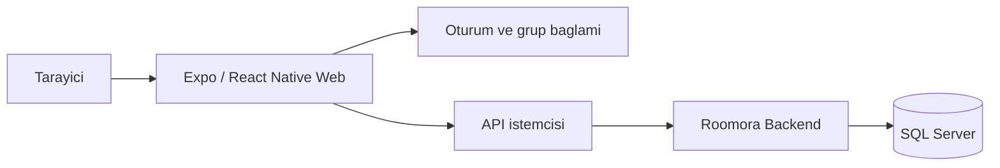

# Roomora Web

Roomora'nin web istemcisi ev ve gezi gruplarinin ortak harcamalarini, odemelerini ve borc-alacak ozetini tarayicida sunar. Ev gruplarinda fatura ve ortak notlar da bulunur.

Bu repo, ayni kod tabanini web ve mobil tarayici deneyimine yakin bir yapida surdurmek icin Expo ve React Native Web uzerinde gelistirilmektedir.

## Neler Var?

- Giris, kayit ve oturum akislari
- Ev grubu olusturma, secme ve uye daveti
- Duzensiz harcama ve duzenli gider yonetimi
- Faturalar, odemeler ve borc-alacak ekranlari
- Ev notlari ve ortak liste deneyimi
- Responsive arayuz ve mobil tarayici odakli ekran duzenleri

## Teknoloji

- Expo
- React Native Web
- React Navigation
- Axios
- TanStack Query

## Yerel Calistirma

```bash
npm install
npm start
```

Web preview:

```bash
npm run web
```

Production web build:

```bash
npm run web:build
```

## Proje Haritasi



- `App.js`: uygulama giris noktasi ve navigation yapisi
- `src/screens/`: urun ekranlari
- `src/services/api.js`: API baglanti katmani
- `src/context/`: oturum ve uygulama durum yonetimi
- `src/shared/`: tema, ortak bilesenler ve yardimci yapilar

## Gelistirme Notu

Bu proje, urun tarafinda hizli iterasyon yapabilmek icin pragmatik bir yapiyla ilerliyor. Odak noktasi; gundelik kullanimda rahat hissettiren, temiz ve tutarli bir deneyim sunmak.
